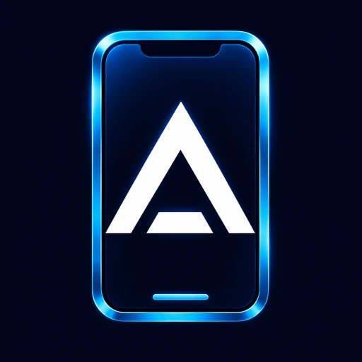

# Agent Zero Mobile Apps

Small Android and Apple download buttons at the bottom of your Agent Zero sidebar, plus a Mobile Apps section on the Home dashboard. Android gets an APK download, installation help, and locally generated QR codes for installing the app and connecting to your HTTPS server. Apple opens the [iOS public beta](https://testflight.apple.com/join/xqAFS5er).

## Install

1. Open **Plugins → Install** in the Agent Zero WebUI.
2. Choose the Git URL option and paste `https://github.com/TerminallyLazy/a0-mobile-apps`.
3. Install, then reload the WebUI. Find the Android and Apple icons above the sidebar version number and **Agent Zero on mobile** on Home.

Alternatively, download [MobileApps.zip](https://github.com/TerminallyLazy/a0-mobile-apps/releases/latest/download/MobileApps.zip) and upload it through the plugin manager. The plugin name is `mobile_apps`.

Requires Agent Zero with the plugin manager and `sidebar-bottom-wrapper-end` and `welcome-actions-end` extension points (tested on the October 2026 framework). Older builds without that extension need a server update.

## Connect your phone

**Android:** select the Android icon, scan the install-page QR with your camera, and install the APK. Then choose **Scan QR code** in the app and scan the server QR. Review the address before connecting. You can also use **Open in Android** on your phone.

**iPhone / iPad:** select the Apple icon and join the TestFlight beta. Connect to your server in the iOS app.

Android requires a trusted HTTPS root address. If you opened the WebUI over local HTTP, the dialog reads the existing Remote Control tunnel status. If no usable HTTPS link exists, create one in **Remote Control** and reopen the dialog. The plugin never starts a tunnel or changes authentication.

[Android downloads](https://terminallylazy.github.io/a0-android/) · [Android source](https://github.com/TerminallyLazy/a0-android) · [iOS beta](https://testflight.apple.com/join/xqAFS5er)

## Updates and removal

This standard user plugin lives under `/a0/usr/plugins/mobile_apps`. It uses the sidebar footer extension and writes no core WebUI files. It survives server image updates when `/a0/usr` is persisted. Future incompatible extension-point changes may require a plugin update.

Use the plugin manager to update, disable, or uninstall. Reload after changing activation. There are no background processes, dependencies, settings, or credentials to remove.

## Migrating the old WebUI bridge

The old `AgentZero-WebUI-Install.zip` edited core HTML and is retired. Install this plugin, then follow the [one-time migration instructions](https://github.com/TerminallyLazy/a0-android/tree/main/distribution/webui) to remove those marked blocks. Normal plugin installation does not edit or restore server files. A fresh server image already has clean core files and needs no migration.

## Privacy

QR codes are generated in your browser using Agent Zero’s bundled library. No external QR service receives the address. Connection links carry only an HTTPS origin: credentials, paths, query strings, fragments, and loopback addresses are rejected. The installation-page link keeps your server address in a URL fragment, which is not sent to the page host. Standard server login remains required.

Opening download/help links visits GitHub or GitHub Pages; the Apple link visits TestFlight. The only server call is the existing CSRF-aware `tunnel_proxy` status read, used only when the current origin is unsuitable for phone pairing.

## Development

Run `node --test tests/*.test.mjs`. Runtime files are in `webui/` and `extensions/webui/`; there is no backend, install hook, or execute script. The connection format matches Agent Zero Android 0.1.6.

MIT license. See THIRD-PARTY-NOTICES.txt for branding attribution.
